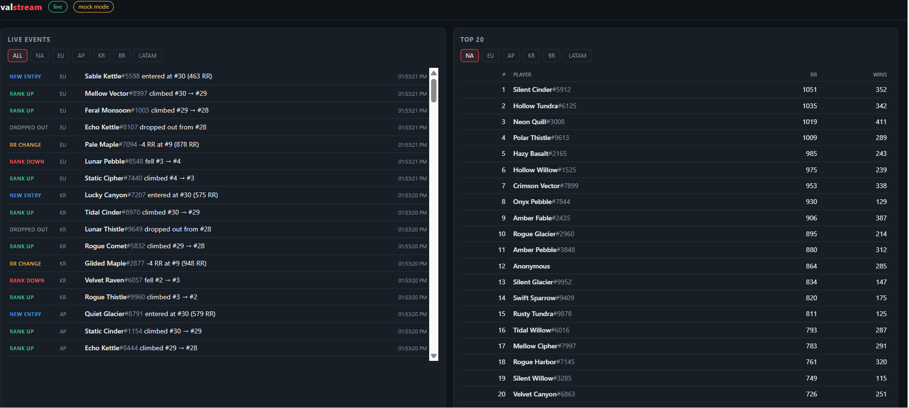
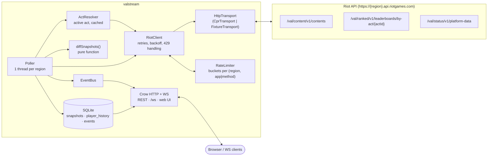

# valstream

**valstream** is a C++20 service that watches Riot's official VALORANT ranked leaderboards in every region, detects
what changed since the last look (who climbed, who fell, who entered or dropped out of the top N, whose RR moved)
and pushes those changes to clients in real time over WebSocket. It respects Riot's rate limits by design: a
thread-safe limiter mirrors Riot's application and method limits per region and re-syncs itself from every
response's headers. Everything is persisted in SQLite for history queries, and a mock mode with recorded fixtures
lets the whole pipeline run without an API key. valstream only mirrors Riot's ladder; it never computes a rating or
ranking of its own.

> **Demo GIF:** 


## Architecture



Per poll, for each region: resolve the active act → fetch the top N in pages of 200 → diff against the previous
snapshot → store the snapshot (if it changed) and the events → publish events → WebSocket fan-out.

| Component | Files | Responsibility |
|---|---|---|
| `HttpTransport` | `http.hpp`, `cpr_transport.cpp`, `fixture_transport.cpp` | Network seam. Live = cpr/libcurl, mock = fixtures, tests = scripted fakes |
| `RateLimiter` | `rate_limiter.hpp/.cpp` | Riot app + method limits per region, header sync, Retry-After penalties |
| `RiotClient` | `riot_client.hpp/.cpp` | Typed endpoints, retry/backoff, error mapping to `Result<T>` (no exceptions) |
| `ActResolver` | `act_resolver.hpp/.cpp` | Finds the active act from content, refreshes hourly, survives content outages |
| `Poller` | `poller.hpp/.cpp` | Worker thread per region, pagination, status caching, graceful stop |
| `diffSnapshots` | `diff_engine.hpp/.cpp` | `(previous, current) -> events`, no side effects |
| `SnapshotStore` | `snapshot_store.hpp/.cpp` | SQLite persistence and queries |
| `EventBus` | `event_bus.hpp/.cpp` | Thread-safe pub/sub between pollers and WebSocket clients |
| Server | `server.hpp/.cpp` | Crow REST + WebSocket + static UI |
| Config | `config.hpp/.cpp` | `config.json` + env overrides |

## Quick start

Requirements: Linux or WSL2, GCC 13+ (or Clang 16+), CMake 3.25+, Ninja, and [vcpkg](https://github.com/microsoft/vcpkg).

```bash
git clone https://github.com/microsoft/vcpkg.git ~/vcpkg && ~/vcpkg/bootstrap-vcpkg.sh
export VCPKG_ROOT=~/vcpkg

cmake --preset release            # vcpkg builds dependencies on first run (several minutes)
cmake --build --preset release
ctest --preset release
```

### Mock mode (no API key)

```bash
./build/release/valstream         # no RIOT_API_KEY -> mock mode automatically
# open http://localhost:8080
```

Mock mode serves the recorded responses in `fixtures/`. Each region has two leaderboard snapshots (`*_a.json`,
`*_b.json`) that alternate on every poll (every 5 s in mock mode), and the differences between them trigger every
event type, so the live feed keeps moving.

### Live mode (with a key)

```bash
cp .env.example .env              # put your key from developer.riotgames.com in .env
set -a; source .env; set +a
./build/release/valstream         # or: ./build/release/valstream path/to/config.json
```

With a development key, keep `pollIntervalSeconds` ≥ 4 for `topN: 500`. The service warns at startup if the
interval is shorter than the app rate limit allows. It would still not exceed the limit; requests would just queue.

### Docker

```bash
docker build -t valstream .
docker run --rm -p 8080:8080 valstream                                     # mock mode
docker run --rm -p 8080:8080 -e RIOT_API_KEY -v valstream-data:/app/data valstream   # live
```

### Configuration

`config.json` (all keys optional), then environment overrides:

| Key | Env override | Default |
|---|---|---|
| `regions` | `VALSTREAM_REGIONS=na,eu` | all six: `na eu ap kr br latam` |
| `pollIntervalSeconds` / `mockPollIntervalSeconds` | `VALSTREAM_POLL_INTERVAL` (sets both) | `60` / `5` |
| `topN` | `VALSTREAM_TOP_N` | `500` |
| `port` | `VALSTREAM_PORT` | `8080` |
| `dbPath` | `VALSTREAM_DB_PATH` | `valstream.db` |
| `mockMode` | `VALSTREAM_MOCK=true` | `false` (forced on without a key) |
| `statusIntervalSeconds`, `actRefreshSeconds` | n/a | `300`, `3600` |
| `appRateLimit` | n/a | `"20:1,100:120"` (dev key). Corrected from response headers at runtime |
| `fixturesDir`, `webRoot`, `locale` | n/a | `fixtures`, `web`, `en-US` |
| n/a | `RIOT_API_KEY` | unset |

`./valstream --print-config` prints the effective config (the key appears only as `"set"`/`"unset"`) and exits.

## API

```bash
curl localhost:8080/health
# {"mockMode":true,"regions":{"na":{"actId":"4c4b…","lastError":"","lastPollAt":1791338959722,"players":30},…},
#  "status":"ok","uptimeSeconds":15,"wsClients":1}

curl localhost:8080/leaderboard/na
# {"actId":"4c4b…","fetchedAt":1791338959722,"region":"na","shard":"na","totalPlayers":18452,
#  "players":[{"puuid":"2Myt…","gameName":"Silent Cinder","tagLine":"5912","leaderboardRank":1,
#              "rankedRating":1051,"numberOfWins":352,"competitiveTier":27}, …]}

curl 'localhost:8080/player/2MytI7V3Qceu-Zud6XF-S71ZC7bWNgUkLAoCglPYlwoddt-Plw6u-j8qBGS5JdlDvQaRqsrl9ZzJce/history?limit=3'
# {"puuid":"2Myt…","history":[{"region":"na","actId":"4c4b…","fetchedAt":1791338954717,
#   "leaderboardRank":1,"rankedRating":1051,"numberOfWins":352}, …]}

curl 'localhost:8080/events?region=eu&limit=2'
# {"events":[{"type":"RANK_DOWN","region":"eu","actId":"4c4b…","puuid":"Bkub…","gameName":"Mellow Vector",
#   "tagLine":"8997","oldRank":29,"newRank":30,"oldRR":489,"newRR":489,"timestamp":1791338959722}, …]}

curl localhost:8080/status/kr
# Riot's PlatformDataDto as last fetched: {"id":"kr","name":"VALORANT","maintenances":[],"incidents":[…],…}
```

| Endpoint | Notes |
|---|---|
| `GET /` | Web UI (`web/index.html`) |
| `GET /health` | Per-region last poll time, player count, last error |
| `GET /leaderboard/{region}` | Latest stored snapshot. `400` unknown region, `404` none yet |
| `GET /player/{puuid}/history?limit=` | Oldest first, most recent `limit` points (default 100, max 1000) |
| `GET /events?region=&limit=` | Newest first. `region` optional (default all), `limit` default 50, max 500 |
| `GET /status/{region}` | Cached VAL-STATUS-V1, refreshed every `statusIntervalSeconds` |
| `WS /ws` | Live events. Optional region filter (below) |

Event types: `RANK_UP`, `RANK_DOWN`, `NEW_ENTRY` (no `oldRank`/`oldRR`), `DROPPED_OUT` (no `newRank`/`newRR`),
`RR_CHANGE`.

### WebSocket session

```text
$ websocat ws://localhost:8080/ws
> {"subscribe": ["na", "kr"]}
< {"subscribed":["kr","na"]}
< {"type":"RANK_UP","region":"na","actId":"4c4b…","puuid":"-3bX…","gameName":"Neon Quill","tagLine":"3008","oldRank":3,"newRank":2,"oldRR":1019,"newRR":1038,"timestamp":1791338964726}
< {"type":"RANK_DOWN","region":"na","actId":"4c4b…","puuid":"AVM-…","gameName":"Hollow Tundra","tagLine":"6125","oldRank":2,"newRank":3,"oldRR":1035,"newRR":1035,"timestamp":1791338964726}
> {"subscribe": []}
< {"subscribed":[]}
> {"subscribe": ["euw"]}
< {"error":"unknown region in subscribe list"}
```

A client that never sends `subscribe`, or sends an empty list, receives every region.

## Design decisions

**Why fixed-window token buckets.** Riot counts requests in fixed windows that start at the first request
(`20:1,100:120` = 20 per 1 s *and* 100 per 120 s). A classic token bucket refills continuously, so it would allow a
full burst of 100 at t=0 and then ~50 more by t=60s. Riot's 120 s window would count 150 and answer 429. valstream's
buckets refill *all at once* when their window ends, matching Riot's accounting, and each window is padded by 100 ms
to absorb clock skew and latency. A request needs a token from every window of both its **app** bucket
(`region, "app"`) and its **method** bucket (`region, "leaderboard"`). Tokens are taken from both buckets in one step
under one lock, so a request never holds one token while waiting on the other bucket.
`RateLimiter::tryAcquire` returns the exact wait until the next opening, so `acquire()` sleeps exactly that long, or
returns false immediately if the wait would exceed its timeout. Time comes from an injected `Clock`, which makes every
limiter and backoff test deterministic and instant.

**How limits are synced.** Every response passes its headers to `syncFromHeaders`:
- `X-App-Rate-Limit` / `X-Method-Rate-Limit` replace the configured limits. Progress is kept in windows whose duration
  didn't change. Method limits aren't known until the first response, and until then only the app bucket gates.
- `X-*-Rate-Limit-Count` raise local counts to Riot's view, never lower them. Riot may have seen requests we didn't
  make (another process sharing the key), and in-flight requests may be missing from Riot's numbers. Taking the max is
  the safe direction.
- The response's own request always counts as at least one in every window, even if the count headers are missing.
- On a 429, `Retry-After` blocks the bucket named by `X-Rate-Limit-Type` (`application` → app bucket, otherwise the
  method bucket). Other threads sharing that bucket wait too, instead of each discovering the 429 independently.
  5xx and transport errors retry with exponential backoff plus jitter. Other 4xx return immediately as typed
  `ApiError`s.

**Threading model.** One `std::jthread` per region runs the poll loop. It sleeps on a `condition_variable_any` tied
to its `stop_token`, so SIGINT/SIGTERM (caught by Crow) wakes idle workers immediately. The limiter, act resolver,
store and event bus are shared and each guards its state with one mutex. Contention is negligible at a cadence of
one poll per region per minute. Crow runs its own I/O thread pool for REST and WebSocket. `EventBus::publish` runs
handlers on the poller thread under a shared lock. `unsubscribe` takes the exclusive lock, which guarantees a handler
never runs after it is removed, so the WebSocket hub can be destroyed safely during shutdown.

**Why the diff engine is a pure function.** `diffSnapshots(previous, current)` has no clock, I/O or state. Every rule
(rank events beat RR events, anonymized players are skipped, duplicate puuids keep the best rank, deterministic
ordering) is tested with literal inputs, and the same function serves live polling, restarts and tests. Context
decisions live in the `Poller`: no events on the very first snapshot, none across an act change, and after a
restart the poller diffs against the last stored snapshot instead of starting cold.

**Errors.** Remote API failures are values (`Result<T>` holding `T` or `ApiError{kind, httpStatus, message}`), because
they are expected and the caller decides what to do. Local failures (SQLite, malformed config) throw. They indicate
bugs or broken environments, and the poll loop logs them and keeps the service up.

## Testing

```bash
ctest --preset release         # 69 tests
cmake --preset asan && cmake --build --preset asan && ctest --preset asan   # Debug + ASan + UBSan
```

| Suite | Covers |
|---|---|
| `ParseRateLimits`, `RateLimiter` | Header parsing (valid, whitespace, 15 malformed cases), burst then exact wait, window starts at first request, no continuous refill, multi-window, app × method gating, region isolation, atomic acquire, limit/count sync, never lowering counts, penalties, blocking acquire and timeout, 16-thread over-grant check, real-clock concurrency |
| `RiotClientTest` | URL and `X-Riot-Token`, all three endpoints, anonymized players, 429 + Retry-After (recorded fixture), app-scope penalties, missing Retry-After, 5xx backoff, max attempts, transport errors, 4xx mapping without retry, invalid args never sent, malformed bodies, own-limiter timeout |
| `PickActiveAct`, `ActResolverTest` | Act vs episode, untyped fallback, caching, act rollover, stale value on outage, errors |
| `DiffEngine` | Every event type, one event per player, empty snapshots, anonymized players, missing names, renames, duplicate puuids, ordering, determinism, fixture coverage |
| `SnapshotStore` | Round trip, history ordering/limits, event filters |
| `PipelineTest` (integration) | FixtureTransport → RiotClient → Poller → DiffEngine → SnapshotStore + EventBus: all five event types published and persisted, pagination, resume after restart, status cache, real worker threads streaming three regions and stopping in < 2 s |

CI (`.github/workflows/ci.yml`) runs both presets on `ubuntu-latest`, with vcpkg binary caching keyed on `vcpkg.json`.

## Known limitations

- **Pagination isn't atomic.** The top 500 takes three requests. If the board shifts between them, a player can
  appear twice (handled: the best rank wins) or be missed for one poll. A missed player shows up as a `DROPPED_OUT`
  followed by a `NEW_ENTRY` on the next poll. A poll is all-or-nothing: if any page fails, nothing is diffed or
  stored, so an outage never looks like the whole board dropping out.
- **`DROPPED_OUT` means "left the tracked top N"**, not "lost Radiant". Players near rank N bounce in and out.
- **Anonymized players** have no stable identity, so they're shown in snapshots but never produce events.
- **Rank changes are often passive**: when one player drops out, everyone below moves up. Each move is a real
  `RANK_UP` on Riot's ladder, but a busy board can produce many events per poll.
- **No retention.** Snapshots are only stored when they differ from the previous one, but nothing prunes old rows.
  Add a retention job before running this for months.
- **Single process.** Rate-limit state is in memory. Several instances sharing one key converge through count-header
  sync but can still briefly overshoot. A shared limiter (e.g. Redis) would fix that.
- **Shutdown** waits for any in-flight HTTP request (10 s timeout), or for a rate-limiter wait that is already in
  progress.
- **No auth or TLS on the server.** Put it behind a reverse proxy before exposing it publicly.

## API schema assumptions (verify against the live API)

These are modeled on Riot's documented DTOs. Every field outside them is optional in our parser and tagged
`ASSUMPTION` in `include/valstream/types.hpp`.

1. **`ActDto.type` / `ActDto.parentId`** are not in the documented ActDto (`id`, `name`, `isActive`,
   `localizedNames`), but the live content response appears to include them. The active **episode** and the active
   **act** are both `isActive: true`. We pick the active entry with `type == "act"`. If `type` is missing, we pick
   the last active entry, assuming content lists episodes before their acts.
2. **Anonymized leaderboard players** come back with `puuid`, `gameName` and `tagLine` omitted or empty. Empty
   strings are treated as absent.
3. **`PlayerDto.competitiveTier`** is undocumented but seen in practice. It is optional and only passed through.
4. **`LeaderboardDto.totalPlayers`** is used only as a pagination stop hint. A short page also ends pagination.
5. **`shard` for `br`/`latam`** may differ from the region name. We store whatever Riot returns and key everything
   by the region we queried.
6. **VAL-RANKED-V1 access** may require a production (not development) key. With a dev key the leaderboard calls may
   return 403, which surfaces as `forbidden` in `/health` `lastError`.
7. **Method rate limits** for the VAL endpoints are learned at runtime. The mock's `250:10` is a placeholder, not a
   documented value.
8. **`Retry-After`** is parsed as delta-seconds (Riot's format). An HTTP-date value is ignored, and the client
   falls back to a 1 s penalty.
9. **Status `id`/`name`**: the mock rewrites `id` to the region. Live values may be uppercase or shard names.

## Project layout

```
include/valstream/   public headers, one per component
src/                 implementations + main.cpp
tests/               GoogleTest suites + integration test
fixtures/            content, status, 429 response, two leaderboard snapshots per region
web/index.html       self-contained UI (no build step)
config.json          defaults; see table above
```

---

valstream isn't endorsed by Riot Games and doesn't reflect the views or opinions of Riot Games or anyone officially
involved in producing or managing Riot Games properties. Riot Games and all associated properties are trademarks or
registered trademarks of Riot Games, Inc.
